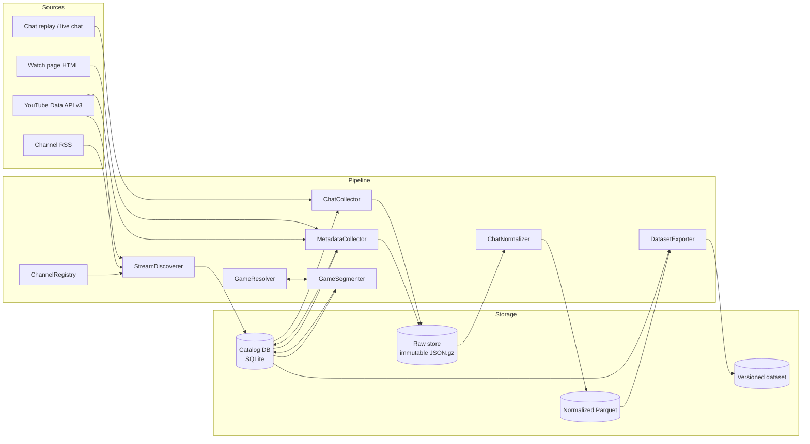
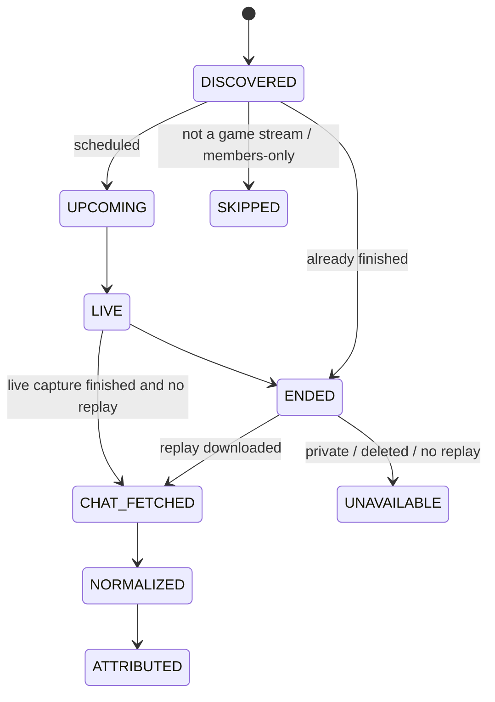

# システム設計: ゲーム配信ライブチャット データセット収集基盤

この文書は、日本のゲーム配信者のYouTube Liveチャットを収集し、各コメントをその時点でプレイ中のゲームに紐づける仕組みを説明します。

- ステータス: 設計段階(未実装)
- 英語版(正): [SystemDesign.md](SystemDesign.md)

## 1. 目的

最終成果物は、**各チャットメッセージが `game_id` を持つ**データセットです。ゲームが特定できない区間には、「非ゲーム」または「不明」のラベルを明示的に付けます。パイプラインは再現可能な形で構築します。これにより「配信者がマイクラをプレイ中に投稿された全コメント」や「ジャンル別のチャット反応」といった分析ができるようになります。

### 1.1 対象範囲

| 対象 | 対象外(当面) |
| --- | --- |
| 公開ライブ配信とそのアーカイブ(チャットリプレイ) | メンバー限定配信、削除・非公開化されたアーカイブ |
| 日本の配信者(VTuberを含む) | ショート動画、プレミア公開 |
| **時間区間(セグメント)単位**でのゲーム紐づけ | 映像フレーム単位のゲーム認識(後続フェーズで対応予定) |
| チャット本文、スパチャ、メンバーシップ、ステッカー、絵文字 | 映像・音声・文字起こし |

### 1.2 要件

機能要件

- F1: 対象チャンネルの台帳を管理し、各チャンネルの選定理由を記録する
- F2: 登録チャンネルの終了済み配信と予定配信を検出する
- F3: 各配信のチャットを全件取得し、全メッセージに動画内の相対時刻を付ける
- F4: どのゲームを、どの時間区間(セグメント)でプレイしていたかを特定する
- F5: `マイクラ`・`Minecraft`・`MC` のような表記揺れを、1つの正規ゲームに名寄せする
- F6: メッセージとゲームを結合した、バージョン付きのデータセットを出力する

非機能要件

- N1: **冪等性と再開可能性。** 各ステージを再実行しても重複が生じず、中断したジョブは途中から再開できる
- N2: **生データは不変。** 取得したレスポンスはそのまま保存し、パーサを改修したときに正規化をやり直せるようにする
- N3: **出自の記録。** 全てのゲームラベルに、根拠とした情報源と信頼度を記録する
- N4: **クォータへの配慮。** YouTube Data API の既定上限 10,000 units/日 に収める
- N5: **プライバシー保護。** 派生データでは、コメント投稿者の識別子を全て仮名化する

## 2. データソースの制約

以下の制約が、設計全体を方向づけています。

| 必要な情報 | 取得元 | 備考 |
| --- | --- | --- |
| チャンネルの新着・配信中の動画 | チャンネルRSS `https://www.youtube.com/feeds/videos.xml?channel_id=...` | クォータを消費せず、直近約15件を返す。ポーリングに向く |
| 過去のアップロード履歴の全件 | Data API `playlistItems.list`(アップロード再生リスト) | 50件あたり1 unit。過去分の取得(バックフィル)に使う |
| 配信のメタデータ | Data API `videos.list`(`snippet`, `liveStreamingDetails`, `contentDetails`, `topicDetails`) | 50本あたり1 unit。`actualStartTime`/`actualEndTime`、`categoryId`(20 = ゲーム)、ジャンル粒度の `topicCategories` が取れる。**ゲームタイトルは取れない** |
| ゲームタイトル(動画単位) | 視聴ページの「ゲーム」カード(`ytInitialData` 内) | 配信者が設定するもので、自動生成のゲームトピックチャンネルにリンクしている。その `browseId` を安定IDとして使える。内部構造は時期によって変わるため、壊れにくいパーサが必要(**Phase 0 のスパイクで要検証**) |
| 配信中のゲーム切り替え | チャプター(概要欄のタイムスタンプ行)、タイトルの `【...】`、ハッシュタグ | ヒューリスティックで、別名辞書が必要 |
| 終了済み配信のチャット | `yt-dlp`(`live_chat` 字幕トラック)または `chat-downloader` によるチャットリプレイ | クォータを消費しない。各メッセージに `videoOffsetTimeMsec` がある。モデレーターが削除したメッセージは含まれない |
| 配信中のチャット | `chat-downloader` / `pytchat`(または Data API `liveChatMessages.list`。こちらはクォータを消費) | アーカイブを削除・非公開化する配信者向けに必要 |

## 3. 全体構成



各ステージは入力をストレージから読み、出力をストレージに書きます。ステージ同士が直接呼び出し合うことはありません。そのため各ステージを独立して再実行でき、オーケストレータはカタログDB上のジョブキューだけで済みます。

## 4. パイプラインのステージ

| # | ステージ | 入力 | 出力 | 起動タイミング |
| --- | --- | --- | --- | --- |
| 1 | `ChannelRegistry` | シードCSV(`Config/Channels.csv`)と、任意のチャンネル探索 | `channels` | 手動/週次 |
| 2 | `StreamDiscoverer` | `channels` | `videos`(状態 `DISCOVERED`) | RSSを5〜10分ごと。APIによるバックフィルは必要時 |
| 3 | `MetadataCollector` | `videos` | API・視聴ページの生スナップショット。`videos` に配信詳細とゲームカードを反映 | 動画の検出時と、配信終了後の再取得時 |
| 4 | `ChatCollector` | 終了済み(または配信中)の動画 | 生チャット `*.jsonl.gz` | アーカイブ: `actualEndTime` から猶予時間が経過した後。ライブ: `liveBroadcastContent=live` の間 |
| 5 | `ChatNormalizer` | 生チャット | `messages` Parquet(`video_id` でパーティション分割) | ステージ4の完了後 |
| 6 | `GameSegmenter` + `GameResolver` | 動画メタデータ、別名辞書 | `game_segments` | ステージ3の完了後。別名辞書を更新したときにも再実行 |
| 7 | `DatasetExporter` | `messages` + `game_segments` + `games` | `Dataset/vYYYYMMDD/` | 手動 |

### 4.1 動画の状態遷移



状態が遷移するたびに、エラー内容と合わせて `collection_runs` に記録します。失敗した項目はバックオフを挟んでリトライします。

## 5. ゲームの紐づけ

本システムの中核部分です。1回の配信で複数のゲームを遊ぶことがあるため、ラベル付けの単位は動画ではなく**セグメント**(`video_id`, `start_ms`, `end_ms`)とします。

### 5.1 根拠となる情報源(優先度の高い順)

| 優先度 | 情報源(`AttributionSource`) | 粒度 | 一般的な信頼性 |
| --- | --- | --- | --- |
| 1 | `MANUAL`: 人手によるアノテーション | セグメント | 正解データ |
| 2 | `CHAPTER`: 概要欄のタイムスタンプ(例: `1:02:03 マリオカート8DX`)を別名辞書で解決したもの | セグメント | ある場合は高い |
| 3 | `GAME_CARD`: YouTubeのゲームカード(トピックチャンネルID) | 動画全体 | 高いが、1動画につき1ゲームしか設定できない |
| 4 | `TITLE`: 括弧やハッシュタグの解析結果(例: `【#マイクラ】`、`【APEX】`)を別名辞書で解決したもの | 動画全体 | 中程度 |
| 5 | `MODEL`(将来): 映像フレームまたはチャットの分類器 | セグメント | モデル次第 |

### 5.2 解決ルール

1. `MANUAL` のセグメントがあれば、それをそのまま採用する。
2. チャプターから1つ以上のゲームが解決できた場合は、チャプターを基にセグメントを作る。ゲームに解決できなかったチャプター(例: `雑談`、`エンディング`)は `NON_GAME` セグメントにする。
3. それ以外でゲームカードがある場合は、動画全体を1つのセグメントにし、情報源を `GAME_CARD` とする。
4. それ以外の場合は、タイトルやハッシュタグの一致結果を動画全体に適用する。
5. 情報源同士が食い違う場合(例: カードはA、タイトルはB)は、優先度の高い方を採用し、`has_conflict = true` を立てて確認対象にする。
6. 根拠が全くない動画には、`UNKNOWN` セグメントを1つ付ける。カタログには残すが、標準の出力からは除外する。

全てのセグメントに `source`・`confidence`・`resolver_version`・`evidence`(一致した元の文字列)を保存します。これにより、紐づけの品質に応じてデータセットを絞り込めます。

### 5.3 ゲームの同一性と別名

- `games` テーブルは、正規ゲーム1つにつき1行です。内部ID `game_id` に加え、任意で外部ID(YouTubeゲームトピックチャンネルID、IGDB ID、Wikidata QID)を持ちます。
- `game_aliases` は表記を `game_id` に対応づけます(例: `マイクラ`、`Minecraft`、`MC`、`マインクラフト`)。照合の前に、NFKC正規化、大文字小文字の統一、`#`・`【】`・空白の除去を行います。
- 別名辞書は段階的に育てていきます。
  1. ゲームカードを観測するたびに、表示された(日本語の)タイトルと共にゲームを追加する。
  2. 未解決のまま頻出するタイトル中の語を確認レポート(`unresolved_tokens`)に一覧化し、人手で整備する。
  3. 任意の拡充ステップとして、IGDBやWikidataから日本語名・英語名を取り込む。
- 別名辞書はバージョン管理します。辞書を変更したときに再実行するのはステージ6だけです。

## 6. データモデル

### 6.1 カタログ(SQLite)

ER図は[英語版](SystemDesign.md#61-catalog-sqlite)と同じです。主なテーブルは次のとおりです。

- `channels`: チャンネルID、名称、国、選定理由、有効フラグ
- `videos`: 動画ID、チャンネル、タイトル、概要欄、状態、予定/実際の開始・終了時刻、カテゴリ、ゲームカード(トピックチャンネルID・タイトル)、リプレイ有無、取得モード
- `games` / `game_aliases`: 正規ゲームと別名辞書
- `game_segments`: `video_id`, `start_ms`, `end_ms`, `game_id`, `label_type`(`GAME`/`NON_GAME`/`UNKNOWN`), `source`, `confidence`, `has_conflict`, `evidence`, `resolver_version`
- `collection_runs`: ステージ実行ログ(ステータス、エラー、時刻)
- `raw_artifacts`: 生ファイルのパス、種類、SHA-256、取得日時

### 6.2 正規化メッセージ(Parquet)

| カラム | 型 | 備考 |
| --- | --- | --- |
| `message_id` | string | YouTubeのメッセージID(重複排除キー) |
| `video_id` | string | |
| `video_offset_ms` | int64 | 動画先頭からの経過時間。セグメントとの結合に使う |
| `posted_at` | timestamp (UTC) | `timestampUsec` から算出 |
| `author_key` | string | 投稿者チャンネルIDのHMAC-SHA256。鍵は `.env` に置いた秘密値 |
| `message_type` | enum | `TEXT`, `SUPER_CHAT`, `SUPER_STICKER`, `MEMBERSHIP`, `GIFT`, `SYSTEM` |
| `text` | string | プレーンテキスト。絵文字は `:shortcode:` に置換 |
| `emoji_ids` | list<string> | メンバー限定のカスタム絵文字も含む |
| `amount_micros`, `currency` | int64, string | スパチャのみ |
| `is_member`, `member_months` | bool, int | バッジ情報から取得 |
| `is_moderator`, `is_owner`, `is_verified` | bool | |
| `capture_mode` | enum | `REPLAY` または `LIVE` |

### 6.3 出力データセット

`Dataset/vYYYYMMDD/` には次のファイルを出力します。

- `messages_with_game.parquet`: メッセージとセグメントを、`video_id` が一致し `start_ms <= video_offset_ms < end_ms` となる条件で結合したもの。`game_id`、`label_type`、`attribution_source`、`attribution_confidence` が付く
- `videos.parquet`、`channels.parquet`、`games.parquet`、`game_segments.parquet`
- `MANIFEST.json`: コードのコミット、`resolver_version`、別名辞書のハッシュ、収集期間、行数
- `DATASHEET.md`: データセットのデータシート(収集方法、フィルタ条件、既知のバイアス、ライセンス上の注意)

## 7. クラス設計

クラス図は[英語版](SystemDesign.md#7-class-design)を参照してください。設計上のポイント(SOLID)は次のとおりです。

- **開放閉鎖原則。** 映像分類器のような新しい紐づけシグナルは、`EvidenceExtractor` の実装を1つ追加するだけで導入できる。`GameSegmenter` の統合ルールは変えない。
- **依存性逆転の原則。** `ChatCollector` は `ChatSource` インターフェースに依存する。そのため `yt-dlp` から `chat-downloader`(または公式API)への切り替えは設定の変更で済む。
- **単一責任の原則。** 取得(ネットワーク)、正規化(純粋な変換)、紐づけ(メタデータに対する純粋なロジック)を分離する。これにより、後の2つはフィクスチャで容易に単体テストできる。

## 8. シーケンス

シーケンス図は[英語版](SystemDesign.md#8-sequences)を参照してください。

- **アーカイブ収集(主経路)。** 10分ごとにRSSで新着を検出 → `videos.list` とゲームカードでメタデータを取得 → 配信終了から2時間以上経ってからリプレイチャットを取得 → 正規化 → 紐づけ。
- **ライブ収集(アーカイブを消すチャンネル向けの補助経路)。** 予定開始時刻が近づいたら状態を監視し、配信中は配信1本につき1つのワーカーでチャットを逐次保存する。後でリプレイが取得できた場合は、`message_id` で重複を除いて統合する。ワーカーは配信の間ずっと動かし続ける必要があるため、ライブ収集はチャンネルごとに有効化する(`channels.capture_live`)。

## 9. ストレージ構成

```text
Data/
  Catalog.sqlite
  Raw/
    Api/{video_id}/{fetched_at}.json.gz
    WatchPage/{video_id}/{fetched_at}.json.gz   # 抽出した ytInitialData のみ
    Chat/{video_id}/{capture_mode}.jsonl.gz
  Normalized/
    Messages/video_id={video_id}/part-0.parquet
Dataset/
  vYYYYMMDD/...
Config/
  Channels.csv
  GameAliases.csv
```

`Data/` と `Dataset/` はgit管理外とします。`Config/` はバージョン管理し、チャンネル選定と別名辞書を再現できるようにします。

容量の目安: 人気配信では1時間あたり約5千〜3万件のメッセージがあります。生のJSONは1件あたり平均約1KB(gzip圧縮後で約100B)なので、1,000配信時間ぶんの生チャットで約1〜3GBになります。

## 10. 運用

- **スケジューリング。** 内部スケジューラ(APScheduler)を持つ常駐プロセス(`collector daemon`)で動かすか、単発のCLIをWindowsタスクスケジューラやcronに登録する。各ステージは1回の起動(tick)ごとに上限件数までを処理する。
- **クォータ。** `QuotaTracker` が日ごとの消費unit数をカタログDBに記録し、設定した上限(既定 8,000)に達したらAPI呼び出しを止める。新着検出はRSSで行うため、定常時のAPI消費は1 tickあたりおおよそ `ceil(動画数/50)` unitで済む。
- **アクセスの節度。** 視聴ページとチャットへのリクエストには、ジッター付きのレート制限をかける(既定: 全体で毎秒1リクエストまで)。HTTP 429や5xxが返ったら指数バックオフする。
- **猶予時間。** アーカイブ処理の完了を待つため、チャットリプレイの取得は `actualEndTime` から2時間以上経ってから行う。配信後にチャプターが追記されることが多いため、メタデータもこのときに再取得する。
- **紐づけの再実行。** 別名辞書やリゾルバを変更したら、`collector attribute --all` でステージ6を再実行する。ネットワークへのアクセスは不要。
- **可観測性。** `collector status` で、状態ごとの件数、直近の失敗、当日のクォータ消費、未解決トークンの上位を表示する。

## 11. データ品質チェック

- 配信時間に対してメッセージ数が少なすぎないか(ダウンロードが途中で切れていないかの検出)
- 配信中に `video_offset_ms` がX分以上空いている箇所がないか
- セグメントが `[0, duration)` を重複なく覆っているか
- 出力ごとの `UNKNOWN` ラベルおよび `has_conflict` の割合
- 人手でアノテーションした検証サンプル(例: 100動画)で情報源ごとの紐づけ精度を測り、`DATASHEET.md` に記載する

## 12. 倫理・法務・プライバシー

- 視聴ページやチャットリプレイからの取得は公式APIの範囲外であり、YouTube利用規約に抵触するおそれがあります。大規模に収集する前に、所属機関と法的根拠(例: 情報解析に関する著作権法第30条の4)を確認し、必要であれば倫理審査の承認を得てください。
- 投稿者のチャンネルIDと表示名は、アクセスを制限した生データ層にだけ保持します。派生データ層では `author_key`(鍵付きHMAC。鍵は `.env` に置き、コミットしない)を使います。
- データセットを公開する場合は、本文ではなく動画ID・メッセージIDと派生特徴量を共有するか、審査で承認された条件に従ってください。
- メンバー限定・非公開・削除済みのコンテンツは収集しません。後から非公開になった動画にはフラグを立て、出力時に除外できるようにします(設定で切り替え可能)。

## 13. 技術スタック

| 用途 | 採用技術 |
| --- | --- |
| 言語・パッケージ管理 | Python 3.12+、`uv`、厳格な型チェック(`mypy --strict` または `pyright` の strict モード)、`ruff`、`black` |
| CLI | `typer` |
| YouTube API | `google-api-python-client` または `httpx` を直接使用 |
| チャット取得 | `yt-dlp`(リプレイ)、`chat-downloader`(ライブ・リプレイ。代替手段) |
| 視聴ページ解析 | `httpx` で取得し、`ytInitialData` のJSONを抽出 |
| カタログDB | `SQLAlchemy` 2.x 経由のSQLite(将来PostgreSQLへ移行可能) |
| 列指向データ | `pyarrow` / Parquet。分析と出力時の結合には `duckdb` |
| スケジューラ | `APScheduler` |
| 設定・秘密情報 | `pydantic-settings` で `.env` を読み込む(`YOUTUBE_API_KEY`, `AUTHOR_HASH_SECRET`) |
| テスト | `pytest`。記録済みのフィクスチャを使い、単体テストではネットワークに接続しない |

## 14. ソース構成案

ディレクトリ名とファイル名は、`CLAUDE.md` の命名規則(UpperCamelCase)に従います。

```text
Src/GameChatCollector/
  Cli.py
  Settings.py
  Domain/            # データクラス: Channel, Video, GameSegment, Evidence ...
  Sources/           # YouTubeApiClient, WatchPageScraper, RssClient, ChatSources
  Stages/            # StreamDiscoverer, MetadataCollector, ChatCollector, ChatNormalizer, DatasetExporter
  Attribution/       # EvidenceExtractors, GameResolver, GameSegmenter, TextNormalizer
  Storage/           # CatalogRepository, RawStore, ParquetWriter
  Operations/        # QuotaTracker, RateLimiter, Scheduler
Tests/
Config/
Docs/
```

## 15. ロードマップ

| フェーズ | 成果物 |
| --- | --- |
| 0. スパイク | 実際の配信約20本で、`ytInitialData` 内のゲームカードの位置、`yt-dlp` のチャットリプレイの形式とオフセット、チャプターの利用率を確認する。結果は `ResearchNotes/` に記録する |
| 1. MVP(アーカイブ) | シードチャンネル → 新着検出 → メタデータ → リプレイチャット → 正規化 → `GAME_CARD`・`TITLE` による紐づけ → 出力 |
| 2. セグメント化 | チャプター解析、別名辞書の整備フロー、未解決トークンのレポート、検証サンプル |
| 3. ライブ収集 | アーカイブを削除するチャンネル向けの `LiveChatSource` ワーカー、リプレイとの重複排除 |
| 4. 拡充 | IGDB / Wikidata との連携(ジャンル、発売年、プラットフォーム)、任意で映像ベースの分類器を `EvidenceExtractor` として追加 |

## 16. 未決事項

1. **チャンネル選定。** 「日本の配信者」の定義をどうするか。選択肢は、キュレーションしたリスト(例: 事務所の所属タレント一覧)、`channels.country = JP`、日本語タイトルなど。サンプリングのバイアスに直結するため、決めた内容を記録する必要がある。
2. **収集期間。** これから先の配信だけを対象にする(配信中・直近の配信)のか、過去分のバックフィルも含めるのか。
3. **目標規模。** チャンネル数と配信時間をどれくらいにするか。SQLiteと単一マシンの構成で足りるかが、これで決まる。
4. **公開方針。** データセットを公開するか。公開する場合、どの形式にするか(IDのみか、本文も含めるか)。
5. **アノテーション工数。** 検証用のセグメントアノテーションに、どれだけの人手の時間を割けるか。
