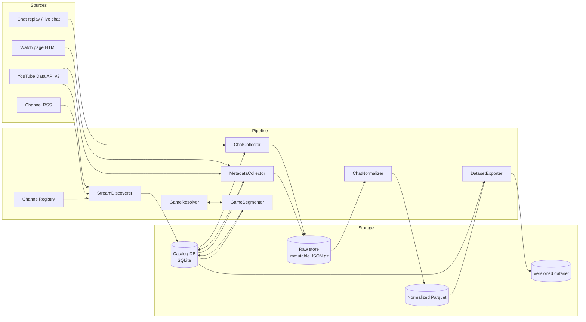
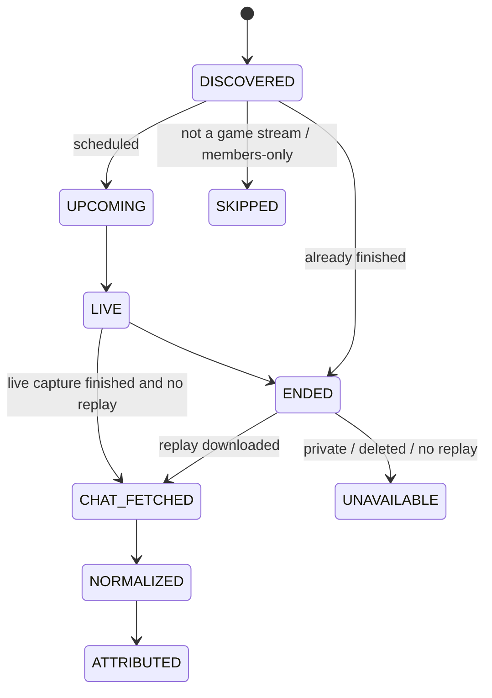
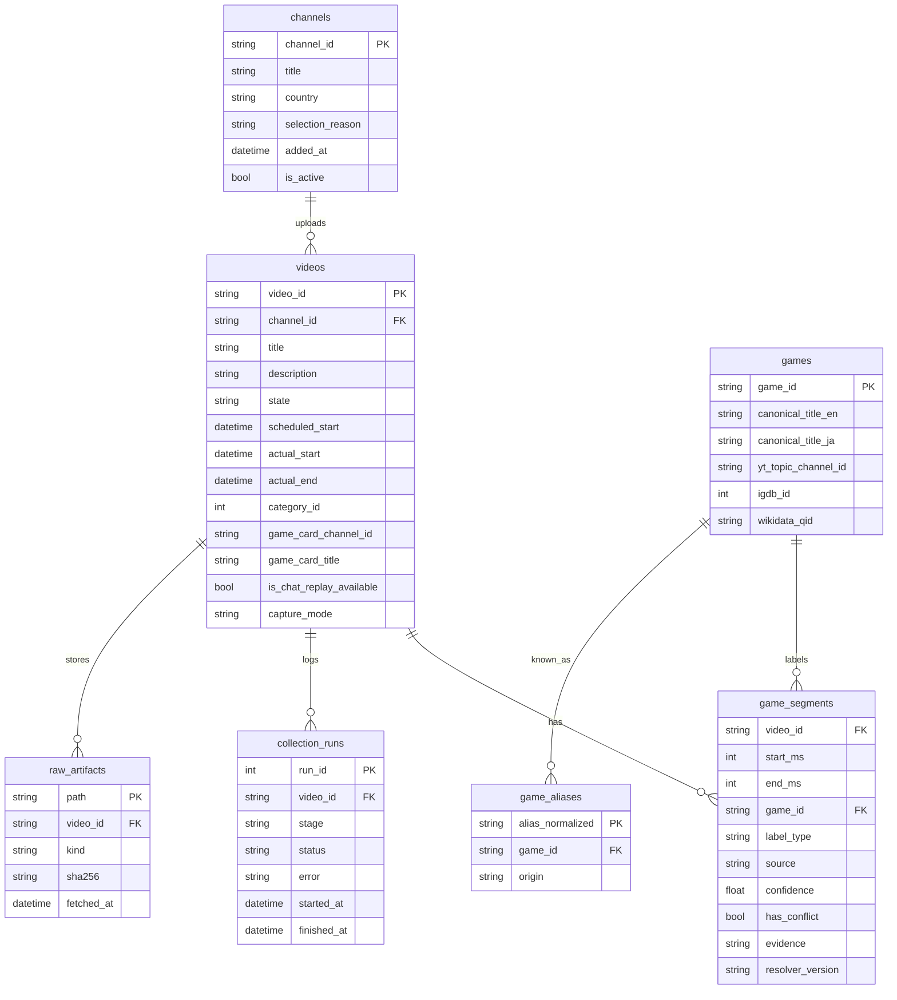
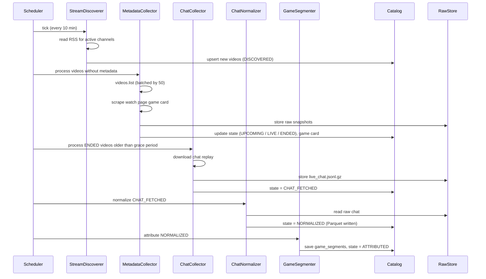
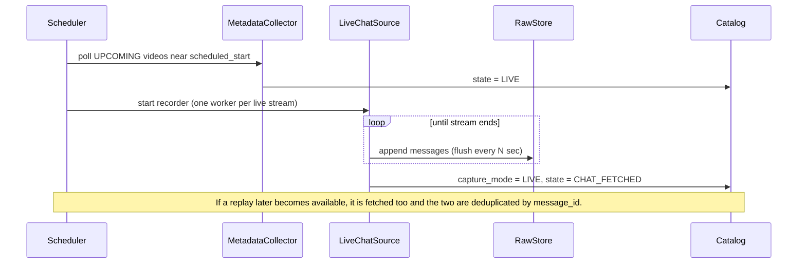

# System Design: Game-Stream Live Chat Dataset Collector

This document describes how the system collects YouTube Live chat from Japanese game streamers and links every comment to the game being played at that moment.

- Status: Design (not yet implemented)
- Japanese version: [SystemDesign.ja.md](SystemDesign.ja.md)

## 1. Goal

Build a reproducible pipeline whose final output is a dataset where **each chat message carries a `game_id`** (or an explicit "non-game / unknown" label), so researchers can run queries like "every comment posted while streamers played Minecraft" or "chat reactions per game genre".

### 1.1 Scope

| In scope | Out of scope (for now) |
| --- | --- |
| Public live streams and their archives (chat replay) | Members-only streams, deleted or private archives |
| Japanese streamers (VTubers and other streamers) | Shorts and premieres |
| Game attribution at the **time-segment level** | Frame-level game recognition (planned for a later phase) |
| Chat text, Super Chats, memberships, stickers, emoji | Video, audio and transcription |

### 1.2 Requirements

Functional

- F1: Keep a registry of target channels, recording why each channel was selected.
- F2: Discover finished and upcoming live streams for registered channels.
- F3: Download the full chat of each stream, with a video-relative timestamp for every message.
- F4: Work out which game(s) were played and over which time ranges (segments).
- F5: Normalize game names (for example `マイクラ`, `Minecraft` and `MC`) to one canonical game entity.
- F6: Export a joined, versioned dataset (message × game).

Non-functional

- N1: **Idempotent and resumable.** Re-running a stage never creates duplicates, and an interrupted job resumes.
- N2: **Raw data is immutable.** Store every raw response as fetched, so normalization can be rerun when parsers change.
- N3: **Provenance.** Every game label records its source and confidence.
- N4: **Quota-aware.** Stay inside the YouTube Data API's default 10,000 units/day.
- N5: **Privacy.** Commenter identifiers are pseudonymized in every derived layer.

## 2. Data Source Constraints

These constraints shape the whole design.

| Need | Source | Notes |
| --- | --- | --- |
| New and live videos per channel | Channel RSS feed `https://www.youtube.com/feeds/videos.xml?channel_id=...` | Costs no quota and returns the latest ~15 entries. Good for polling. |
| Full upload history | Data API `playlistItems.list` on the uploads playlist | 1 unit per 50 items. Used for backfill. |
| Stream metadata | Data API `videos.list` (`snippet`, `liveStreamingDetails`, `contentDetails`, `topicDetails`) | 1 unit per 50 videos. Returns `actualStartTime`/`actualEndTime`, `categoryId` (20 = Gaming) and genre-level `topicCategories`. **It does not return the game title.** |
| Game title (video level) | The "Game" card on the watch page (in `ytInitialData`) | Set by the streamer and links to an auto-generated game topic channel, whose `browseId` gives a stable ID. Its internal structure changes over time, so it needs a robust parser (**to be verified in a Phase 0 spike**). |
| Game transitions within a stream | Chapters (timestamp lines in the description), title brackets `【...】`, hashtags | Heuristic and needs the alias dictionary. |
| Chat of finished streams | Chat replay via `yt-dlp` (`live_chat` subtitle track) or `chat-downloader` | Costs no quota. Each message has `videoOffsetTimeMsec`. Messages removed by moderators are missing. |
| Chat during a live stream | `chat-downloader` / `pytchat` (or Data API `liveChatMessages.list`, which costs quota) | Needed for streamers who delete or privatize their archives. |

## 3. Architecture Overview



Every stage reads its input from storage and writes its output to storage. No stage calls another stage directly. Stages can therefore be rerun independently, and the orchestrator is just a job queue held in the catalog.

## 4. Pipeline Stages

| # | Stage | Input | Output | Trigger |
| --- | --- | --- | --- | --- |
| 1 | `ChannelRegistry` | Seed CSV (`Config/Channels.csv`) plus optional discovery | `channels` | Manual / weekly |
| 2 | `StreamDiscoverer` | `channels` | `videos` (state `DISCOVERED`) | RSS every 5–10 min; API backfill on demand |
| 3 | `MetadataCollector` | `videos` | Raw API/watch-page snapshots; `videos` updated with live details and game card | When a video is discovered, and again once the stream has ended |
| 4 | `ChatCollector` | Ended (or live) videos | Raw chat `*.jsonl.gz` | Archive: after `actualEndTime` + grace period. Live: while `liveBroadcastContent=live` |
| 5 | `ChatNormalizer` | Raw chat | `messages` Parquet, partitioned by `video_id` | After stage 4 |
| 6 | `GameSegmenter` + `GameResolver` | Video metadata, alias dictionary | `game_segments` | After stage 3; rerun whenever the alias dictionary changes |
| 7 | `DatasetExporter` | `messages` + `game_segments` + `games` | `Dataset/vYYYYMMDD/` | Manual |

### 4.1 Video State Machine



Each transition is stored in `collection_runs` together with the error details, so failed items are retried with backoff.

## 5. Game Attribution

This is the core of the system. One stream can contain several games, so the unit of labeling is a **segment** (`video_id`, `start_ms`, `end_ms`), not a video.

### 5.1 Evidence Sources (Highest Priority First)

| Priority | Source (`AttributionSource`) | Granularity | Typical reliability |
| --- | --- | --- | --- |
| 1 | `MANUAL`: human annotation | Segment | Ground truth |
| 2 | `CHAPTER`: description timestamps such as `1:02:03 マリオカート8DX`, resolved through the alias dictionary | Segment | High when present |
| 3 | `GAME_CARD`: YouTube game card (topic channel ID) | Whole video | High, but only one game per video |
| 4 | `TITLE`: bracket or hashtag parsing, for example `【#マイクラ】` or `【APEX】`, resolved through the alias dictionary | Whole video | Medium |
| 5 | `MODEL` (future): frame or chat classifier | Segment | Depends on the model |

### 5.2 Resolution Rules

1. If `MANUAL` segments exist, use them as they are.
2. If chapters resolve to at least one game, build segments from the chapters. Chapters that resolve to no game (for example `雑談` or `エンディング`) become `NON_GAME` segments.
3. Otherwise, if a game card exists, use one segment covering the whole video, with source `GAME_CARD`.
4. Otherwise, use the title or hashtag match for the whole video.
5. If sources disagree (for example, the card says A but the title says B), keep the higher-priority source and set `has_conflict = true` for review.
6. If there is no evidence, the video gets one `UNKNOWN` segment. It stays in the catalog but is excluded from the default export.

Every segment stores `source`, `confidence`, `resolver_version` and `evidence` (the raw string that matched), so the dataset can be filtered by attribution quality.

### 5.3 Game Identity and Aliases

- `games` holds one row per canonical game, with an internal `game_id` and optional external IDs: the YouTube game topic channel ID, IGDB ID and Wikidata QID.
- `game_aliases` maps surface strings to `game_id`, for example `マイクラ`, `Minecraft`, `MC` and `マインクラフト`. Matching is done after NFKC normalization, case folding and stripping of `#`, `【】` and whitespace.
- The alias dictionary is built up step by step:
  1. Every game card seen adds a game together with its displayed (Japanese) title.
  2. Frequent unresolved title tokens are listed in a review report (`unresolved_tokens`) for humans to curate.
  3. An optional enrichment step pulls Japanese and English names from IGDB or Wikidata.
- The alias dictionary is versioned. Changing it triggers a rerun of stage 6 only.

## 6. Data Model

### 6.1 Catalog (SQLite)



`label_type` is one of `GAME`, `NON_GAME` or `UNKNOWN`. `capture_mode` is `REPLAY` or `LIVE`.

### 6.2 Normalized Messages (Parquet)

| Column | Type | Notes |
| --- | --- | --- |
| `message_id` | string | YouTube message ID (deduplication key) |
| `video_id` | string | |
| `video_offset_ms` | int64 | Offset from the start of the video. Used to join with segments. |
| `posted_at` | timestamp (UTC) | From `timestampUsec` |
| `author_key` | string | HMAC-SHA256 of the author's channel ID, keyed with a secret from `.env` |
| `message_type` | enum | `TEXT`, `SUPER_CHAT`, `SUPER_STICKER`, `MEMBERSHIP`, `GIFT`, `SYSTEM` |
| `text` | string | Plain text, with emoji replaced by `:shortcode:` |
| `emoji_ids` | list<string> | Including custom (member) emoji |
| `amount_micros`, `currency` | int64, string | Super Chat only |
| `is_member`, `member_months` | bool, int | From badges |
| `is_moderator`, `is_owner`, `is_verified` | bool | |
| `capture_mode` | enum | `REPLAY` or `LIVE` |

### 6.3 Exported Dataset

`Dataset/vYYYYMMDD/` contains:

- `messages_with_game.parquet`: the messages joined to segments on `video_id` with `start_ms <= video_offset_ms < end_ms`. It adds `game_id`, `label_type`, `attribution_source` and `attribution_confidence`.
- `videos.parquet`, `channels.parquet`, `games.parquet`, `game_segments.parquet`
- `MANIFEST.json`: the code commit, `resolver_version`, alias dictionary hash, collection window and row counts
- `DATASHEET.md`: a datasheet for the dataset (collection method, filtering, known biases and license notes)

## 7. Class Design

```mermaid
classDiagram
  class ChannelRegistry {
    +load_seed(path) list~Channel~
    +list_active() list~Channel~
  }
  class StreamDiscoverer {
    +discover_recent(channel) list~VideoRef~
    +backfill(channel, since) list~VideoRef~
  }
  class YouTubeApiClient {
    +fetch_videos(ids) list~dict~
    +fetch_playlist_items(playlist_id) Iterator~dict~
    -_quota_tracker QuotaTracker
  }
  class WatchPageScraper {
    +fetch_game_card(video_id) GameCard?
  }
  class MetadataCollector {
    +collect(video_id) VideoMetadata
  }
  class ChatSource {
    <<interface>>
    +stream_messages(video_id) Iterator~dict~
  }
  class ReplayChatSource
  class LiveChatSource
  class ChatCollector {
    +collect(video_id, mode) RawArtifact
  }
  class ChatNormalizer {
    +normalize(artifact) Table
  }
  class AuthorPseudonymizer {
    +pseudonymize(channel_id) str
  }
  class EvidenceExtractor {
    <<interface>>
    +extract(video) list~Evidence~
  }
  class ChapterEvidenceExtractor
  class GameCardEvidenceExtractor
  class TitleEvidenceExtractor
  class ManualEvidenceExtractor
  class GameResolver {
    +resolve(surface) GameMatch?
  }
  class GameSegmenter {
    +segment(video) list~GameSegment~
  }
  class CatalogRepository {
    +upsert_video(v)
    +save_segments(video_id, segments)
    +record_run(run)
  }
  class RawStore {
    +put(kind, video_id, bytes) RawArtifact
  }
  class DatasetExporter {
    +export(version) Path
  }

  ChatSource <|.. ReplayChatSource
  ChatSource <|.. LiveChatSource
  EvidenceExtractor <|.. ChapterEvidenceExtractor
  EvidenceExtractor <|.. GameCardEvidenceExtractor
  EvidenceExtractor <|.. TitleEvidenceExtractor
  EvidenceExtractor <|.. ManualEvidenceExtractor
  StreamDiscoverer --> YouTubeApiClient
  MetadataCollector --> YouTubeApiClient
  MetadataCollector --> WatchPageScraper
  ChatCollector --> ChatSource
  ChatCollector --> RawStore
  ChatNormalizer --> AuthorPseudonymizer
  GameSegmenter --> EvidenceExtractor
  ChapterEvidenceExtractor --> GameResolver
  TitleEvidenceExtractor --> GameResolver
  GameSegmenter --> CatalogRepository
```



Design notes (SOLID):

- **Open/closed.** A new attribution signal, such as a frame classifier, is a new `EvidenceExtractor`. The merge rules in `GameSegmenter` stay the same.
- **Dependency inversion.** `ChatCollector` depends on the `ChatSource` interface, so switching from `yt-dlp` to `chat-downloader` (or to the official API) is a configuration change.
- **Single responsibility.** Fetching (network), normalizing (pure transformation) and attributing (pure logic over metadata) are separate. This makes the last two easy to unit-test with fixtures.

## 8. Sequences

### 8.1 Archive Collection (Main Path)



### 8.2 Live Capture (Fallback for Channels That Remove Archives)



Live capture is enabled per channel (`channels.capture_live`), because a recorder worker has to run for the whole length of every stream.

## 9. Storage Layout

```text
Data/
  Catalog.sqlite
  Raw/
    Api/{video_id}/{fetched_at}.json.gz
    WatchPage/{video_id}/{fetched_at}.json.gz   # extracted ytInitialData only
    Chat/{video_id}/{capture_mode}.jsonl.gz
  Normalized/
    Messages/video_id={video_id}/part-0.parquet
Dataset/
  vYYYYMMDD/...
Config/
  Channels.csv
  GameAliases.csv
```

`Data/` and `Dataset/` are git-ignored. `Config/` is version-controlled, which keeps channel selection and the alias dictionary reproducible.

Rough sizing: a popular stream gets about 5k–30k messages per hour. With an average raw message of about 1 KB of JSON (about 100 B gzipped), 1,000 stream-hours of raw chat is about 1–3 GB.

## 10. Operations

- **Scheduling.** A single long-running process (`collector daemon`) with an internal scheduler (APScheduler), or one-shot CLI commands registered in Windows Task Scheduler or cron. Each stage processes a bounded batch per tick.
- **Quota.** `QuotaTracker` records the units spent per day in the catalog and stops API calls at a configurable cap (default 8,000). Discovery uses RSS, so steady-state API usage is roughly `ceil(videos/50)` units per tick.
- **Politeness.** Watch-page and chat requests are rate-limited with jitter (default: at most 1 request per second globally). Workers back off exponentially on HTTP 429 or 5xx responses.
- **Grace period.** Chat replay is fetched at least 2 hours after `actualEndTime`, so YouTube has time to finalize the archive. Metadata is refetched at the same time, because streamers often add chapters after the stream.
- **Re-attribution.** `collector attribute --all` reruns stage 6 when the alias dictionary or resolver changes. It needs no network access.
- **Observability.** `collector status` prints counts per state, recent failures, quota used today and the top unresolved title tokens.

## 11. Data Quality Checks

- Message count compared with stream duration (flags truncated downloads).
- Gaps in `video_offset_ms` longer than X minutes during a stream.
- Segment coverage: segments must tile `[0, duration)` without overlap.
- Share of messages whose label is `UNKNOWN` or `has_conflict`, per export.
- A manually annotated validation sample (for example, 100 videos) to measure the accuracy of each attribution source. This is reported in `DATASHEET.md`.

## 12. Ethics, Legal and Privacy

- Collecting data from the watch page and chat replay is not part of the official API and may conflict with the YouTube Terms of Service. Before collecting at scale, confirm the legal basis with the institution (for example, Article 30-4 of Japan's Copyright Act on information analysis) and get ethics review approval if required.
- Commenter channel IDs and display names exist only in the raw layer, which has restricted access. Derived layers use `author_key` (a keyed HMAC whose key is in `.env` and never committed).
- Public release should share video and message IDs plus derived features rather than raw text, or follow whatever terms the review board approves.
- Members-only, private and deleted content is never collected. If a video becomes private later, it is flagged, and the exporter can exclude it (configurable).

## 13. Technology Stack

| Concern | Choice |
| --- | --- |
| Language / packages | Python 3.12+, `uv`, strict typing (`mypy --strict` or `pyright` strict), `ruff`, `black` |
| CLI | `typer` |
| YouTube API | `google-api-python-client` or plain `httpx` |
| Chat | `yt-dlp` (replay), `chat-downloader` (live and replay; fallback) |
| Watch-page parsing | `httpx` + JSON extraction of `ytInitialData` |
| Catalog | SQLite via `SQLAlchemy` 2.x (could later move to PostgreSQL) |
| Columnar data | `pyarrow` / Parquet; `duckdb` for analysis and export joins |
| Scheduling | `APScheduler` |
| Config / secrets | `pydantic-settings` reading `.env` (`YOUTUBE_API_KEY`, `AUTHOR_HASH_SECRET`) |
| Tests | `pytest` with recorded fixtures (no network in unit tests) |

## 14. Proposed Source Layout

The directory and file names follow the naming conventions in `CLAUDE.md` (UpperCamelCase).

```text
Src/GameChatCollector/
  Cli.py
  Settings.py
  Domain/            # dataclasses: Channel, Video, GameSegment, Evidence ...
  Sources/           # YouTubeApiClient, WatchPageScraper, RssClient, ChatSources
  Stages/            # StreamDiscoverer, MetadataCollector, ChatCollector, ChatNormalizer, DatasetExporter
  Attribution/       # EvidenceExtractors, GameResolver, GameSegmenter, TextNormalizer
  Storage/           # CatalogRepository, RawStore, ParquetWriter
  Operations/        # QuotaTracker, RateLimiter, Scheduler
Tests/
Config/
Docs/
```

## 15. Roadmap

| Phase | Deliverable |
| --- | --- |
| 0. Spike | Confirm on about 20 real streams: the game-card location in `ytInitialData`, the `yt-dlp` chat replay format and offsets, and how often chapters are used. Write the findings to `ResearchNotes/`. |
| 1. MVP (archive) | Seed channels → discovery → metadata → replay chat → normalization → `GAME_CARD` and `TITLE` attribution → export |
| 2. Segments | Chapter parsing, alias curation workflow, unresolved-token report, validation sample |
| 3. Live capture | `LiveChatSource` worker for channels that delete their archives; deduplication against the replay |
| 4. Enrichment | IGDB / Wikidata linkage (genre, release year, platform); optional frame-based classifier as a new `EvidenceExtractor` |

## 16. Open Questions

1. **Channel selection.** Which streamers count as "Japanese streamers"? Options: a curated list (for example, agency rosters), `channels.country = JP`, or Japanese-language titles. This affects sampling bias and should be decided and recorded.
2. **Time window.** Is the dataset forward-looking only (live and recent), or does it include a historical backfill?
3. **Target scale.** How many channels and stream-hours? This decides whether SQLite and a single machine are enough.
4. **Release policy.** Will the dataset be published, and if so, in what form (IDs only or text)?
5. **Annotation budget.** How many hours of manual segment annotation are available for validation?
