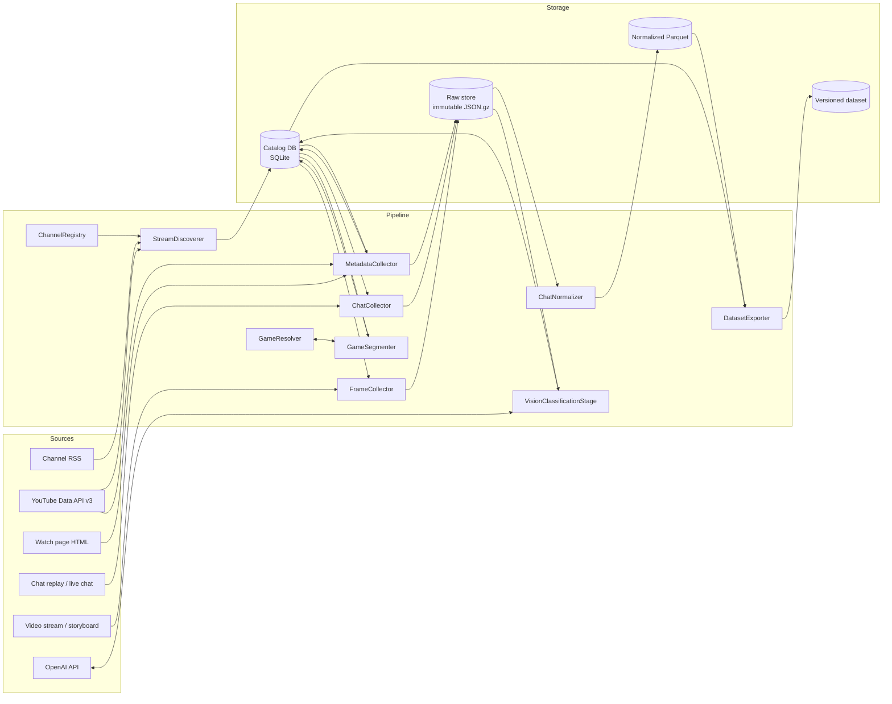
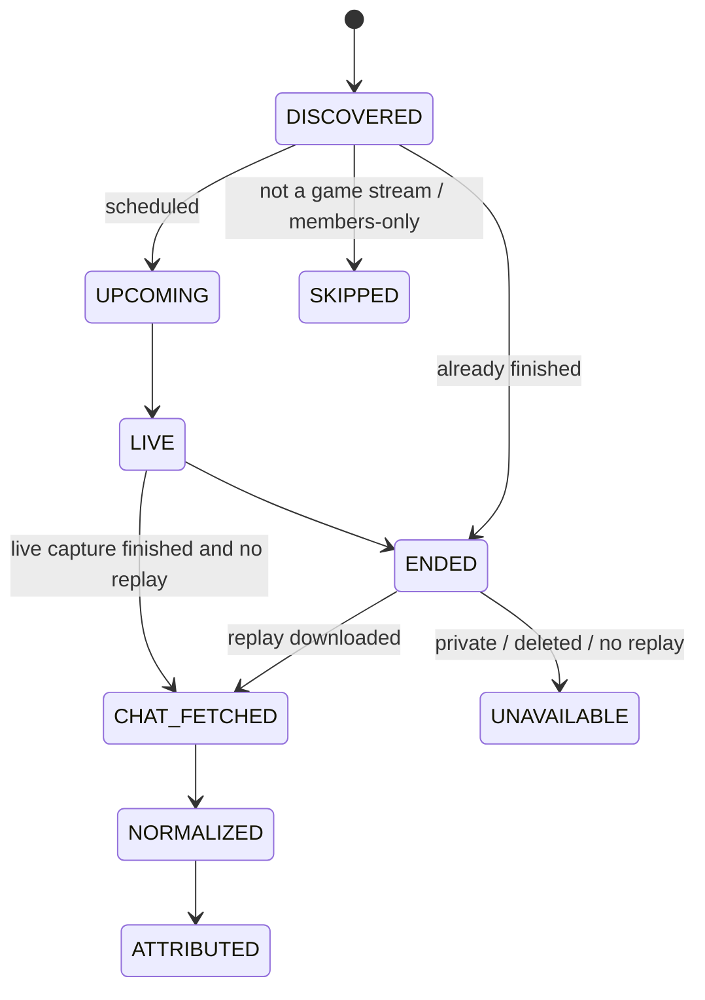
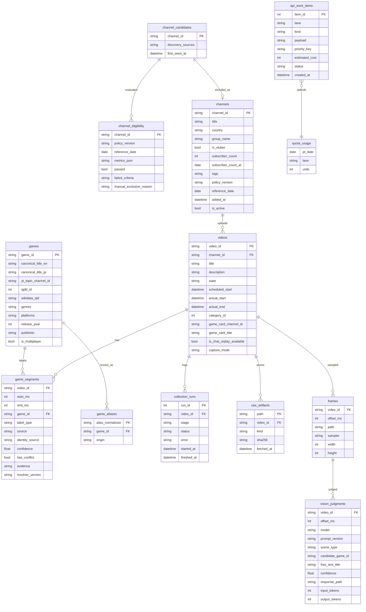
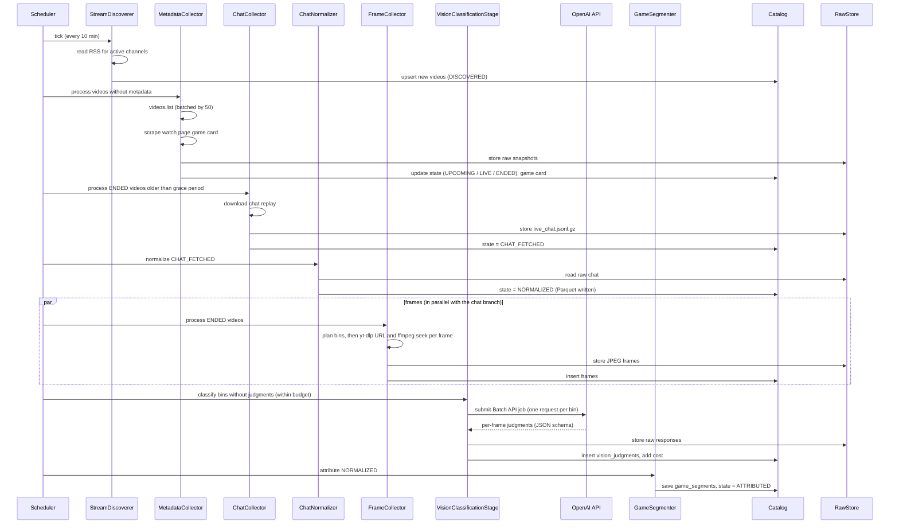
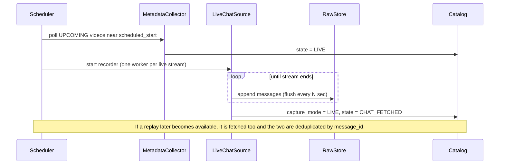

# System Design: Game-Stream Live Chat Dataset Collector

This document describes how the system collects YouTube Live chat from Japanese game streamers and links every comment to the game being played at that moment.

- Status: Design (not yet implemented)
- Japanese version: [SystemDesign.ja.md](SystemDesign.ja.md)

## 1. Goal

Build a reproducible pipeline whose final output is a dataset where **each chat message carries a `game_id`** (or an explicit "non-game / unknown" label), so researchers can run queries like "every comment posted while streamers played Minecraft" or "chat reactions per game genre".

### 1.1 Scope

| In scope | Out of scope (for now) |
| --- | --- |
| Public live streams and their archives (chat replay) | Members-only streams, deleted or private archives |
| Japanese streamers (VTubers and other streamers) | Shorts and premieres |
| Game attribution at the **time-segment level** | Visual segmentation finer than the bin size (30 minutes by default) |
| Coarse visual detection of gameplay from sampled still frames, using a low-cost OpenAI vision model | Downloading full video or audio; transcription |
| Chat text, Super Chats, memberships, stickers, emoji | |

### 1.2 Requirements

Functional

- F1: Decide which channels to include with **one uniform, versioned set of inclusion criteria** that is applied the same way to every candidate (section 4.2). Record the measured values and the result for each candidate.
- F2: Discover finished and upcoming live streams for registered channels.
- F3: Download the full chat of each stream, with a video-relative timestamp for every message.
- F4: Work out which game(s) were played and over which time ranges (segments).
- F5: Normalize game names (for example `マイクラ`, `Minecraft` and `MC`) to one canonical game entity.
- F6: Export a joined, versioned dataset (message × game).
- F7: Let researchers filter the dataset along any combination of **game** (title, genre, platform, attribution quality), **comment** (type, keyword, author, text features) and **channel** (ID, group or agency, VTuber or not, size), without writing joins by hand.

Non-functional

- N1: **Idempotent and resumable.** Re-running a stage never creates duplicates, and an interrupted job resumes.
- N2: **Raw data is immutable.** Store every raw response as fetched, so normalization can be rerun when parsers change.
- N3: **Provenance.** Every game label records its source and confidence.
- N4: **Quota- and cost-aware.** Stay inside the YouTube Data API's default 10,000 units/day, and under a configurable daily spending cap for the OpenAI API.
- N5: **Privacy.** Commenter identifiers are pseudonymized in every derived layer.

## 2. Data Source Constraints

These constraints shape the whole design.

| Need | Source | Notes |
| --- | --- | --- |
| New and live videos per channel | Channel RSS feed `https://www.youtube.com/feeds/videos.xml?channel_id=...` | Costs no quota and returns the latest ~15 entries. Good for polling. |
| Full upload history | Data API `playlistItems.list` on the uploads playlist | 1 unit per 50 items. Used for backfill. |
| Stream metadata | Data API `videos.list` (`snippet`, `liveStreamingDetails`, `contentDetails`, `topicDetails`) | 1 unit per 50 videos. Returns `actualStartTime`/`actualEndTime`, `categoryId` (20 = Gaming) and genre-level `topicCategories`. **It does not return the game title.** |
| Game title (video level) | The "Game" card on the watch page (in `ytInitialData`) | Set by the streamer and links to an auto-generated game topic channel, whose `browseId` gives a stable ID. Its internal structure changes over time, so it needs a robust parser (**to be verified in a Phase 0 spike**). |
| Game transitions within a stream | Chapters (timestamp lines in the description), title brackets `【...】`, hashtags | Heuristic and needs the alias dictionary. |
| Still frames at given times | `yt-dlp` resolves a video-only stream URL, then `ffmpeg -ss <t> -i <url> -frames:v 1` grabs one frame | Downloads only a small byte range per frame. Fallback: `yt-dlp` storyboard sprite sheets (`sb*` formats), which are very small images. |
| What is on screen | Low-cost OpenAI vision model (Chat Completions or Responses API, `detail: "low"`, Structured Outputs) | Paid per token. The Batch API is cheaper when results are not needed immediately. |
| Chat of finished streams | Chat replay via `yt-dlp` (`live_chat` subtitle track) or `chat-downloader` | Costs no quota. Each message has `videoOffsetTimeMsec`. Messages removed by moderators are missing. |
| Chat during a live stream | `chat-downloader` / `pytchat` (or Data API `liveChatMessages.list`, which costs quota) | Needed for streamers who delete or privatize their archives. |

## 3. Architecture Overview



Every stage reads its input from storage and writes its output to storage. No stage calls another stage directly. Stages can therefore be rerun independently, and the orchestrator is just a job queue held in the catalog.

## 4. Pipeline Stages

| # | Stage | Input | Output | Trigger |
| --- | --- | --- | --- | --- |
| 1 | `ChannelRegistry` (`CandidateSource`s + `ChannelEligibilityEvaluator`) | Candidate channels from every discovery source, `Config/ChannelPolicy.yaml` | `channel_candidates`, `channel_eligibility`, `channels` (eligible only) | Monthly re-evaluation, plus manual runs |
| 2 | `StreamDiscoverer` | `channels` | `videos` (state `DISCOVERED`) | RSS every 5–10 min; API backfill on demand |
| 3 | `MetadataCollector` | `videos` | Raw API/watch-page snapshots; `videos` updated with live details and game card | When a video is discovered, and again once the stream has ended |
| 4 | `ChatCollector` | Ended (or live) videos | Raw chat `*.jsonl.gz` | Archive: after `actualEndTime` + grace period. Live: while `liveBroadcastContent=live` |
| 5 | `ChatNormalizer` | Raw chat | `messages` Parquet, partitioned by `video_id` | After stage 4 |
| 6 | `FrameCollector` | Ended videos, bin plan | JPEG frames, `frames` | After `actualEndTime` + grace period. Runs in parallel with stage 4. |
| 7 | `VisionClassificationStage` | Frames + video context | `vision_judgments` | After stage 6, subject to the run policy and spending cap |
| 8 | `GameSegmenter` + `GameResolver` | Video metadata, vision judgments, alias dictionary | `game_segments` | After stages 3 and 7; rerun whenever the alias dictionary or aggregation rules change |
| 9 | `DatasetExporter` | `messages` + `game_segments` + `games` | `Dataset/vYYYYMMDD/` | Manual |

### 4.1 Video State Machine



Each transition is stored in `collection_runs` together with the error details, so failed items are retried with backoff.

### 4.2 Channel Selection Policy (Uniform Inclusion Criteria)

**Principle:** *how* a candidate was found never decides *whether* it is included. Candidates can come from any source. Every candidate is then measured by the same procedure and judged by the same thresholds. Only channels that pass all criteria are collected. This keeps the population well defined, and its bias is documented and measurable.

**Population definition.** "Japanese game streamers" is defined operationally as **Japanese-language** YouTube channels that **regularly live-stream games** and are **at or above a minimum size**. Nationality and residence cannot be observed, so they are not used. The channel's `country` field is self-declared and often empty, so it is recorded but not used as a criterion.

**Criteria.** The values below are proposed defaults and must be confirmed. They are all measured over an observation window that ends on a reference date.

| ID | Criterion | Measurement | Default threshold |
| --- | --- | --- | --- |
| C1 | Japanese language | Share of live-stream titles in the window that contain kana (hiragana or katakana) | ≥ 80% |
| C2 | Game-streaming activity | Number of completed public live streams in the window that are game streams (`categoryId = 20`, or a game card, or a title resolved to a game) | ≥ 8 in 180 days |
| C3 | Game-streaming share | Game streams ÷ all completed live streams in the window | ≥ 30% |
| C4 | Size | `subscriberCount` from `channels.list` on the reference date. Channels that hide their subscriber count fail. | ≥ 10,000 |
| C5 | Chat available | Share of the window's game streams that have chat replay available | ≥ 50% |
| C6 | Channel type | Not an official company, publisher or esports-team channel; not a clip (切り抜き), re-upload or compilation channel; not `madeForKids` (chat is disabled) | Must hold |

C1–C5 are computed automatically from API data. C6 cannot be judged reliably by a machine. Automatic signals (for example, `madeForKids` and clip keywords in the channel name) flag likely failures, and a human confirms each flag against a short written checklist (`Docs/ChannelTypeChecklist.md`, to be written). The decision and the reviewer are logged.

**Candidate discovery (sampling frame).** All sources feed the same candidate table, and each candidate records which sources found it, so source-related bias can be analyzed later.

- `ApiSearchCandidateSource`: Data API `search.list` with `type=video`, `eventType=completed`, `videoCategoryId=20`, `relevanceLanguage=ja` and `regionCode=JP`, run over time windows and a fixed list of query terms. This is the most neutral frame, but costs 100 units per call, so it runs with a fixed daily budget.
- `CsvCandidateSource`: curated lists, such as agency rosters, read from `Config/ChannelCandidates.csv`.
- `CollabSnowballCandidateSource`: channels linked or @-mentioned in the descriptions of included channels' streams.

**Evaluation and versioning.**

- Thresholds, the window length and the query terms live in `Config/ChannelPolicy.yaml`, which carries a `policy_version`. Any change to it is a new version.
- `ChannelEligibilityEvaluator` stores one row per candidate and evaluation in `channel_eligibility`: `(channel_id, policy_version, reference_date, metrics_json, passed, failed_criteria)`.
- Evaluating one candidate costs about 10 API units: `channels.list` is batched 50 at a time, and `playlistItems.list` plus `videos.list` cover the window. 1,000 candidates cost about one day's default quota.
- **Cohort per dataset version.** Each dataset version fixes one evaluation (`policy_version` + `reference_date`). The channels that passed it form the cohort, and streams are exported only for those channels. Channels evaluated after the reference date do not join the cohort until a new dataset version is made. `MANIFEST.json` records the policy version, reference date and cohort size, and the eligibility table is exported as `channel_eligibility.parquet`.
- **Overrides.** Manual *inclusion* outside the criteria is not allowed. Manual *exclusion* is allowed only for documented reasons (for example, a takedown request) and is logged with the reason, so it can be reported.
- `Config/Channels.csv` keeps only curated **attributes** of channels (`group_name`, `is_vtuber`, `tags`). It no longer decides inclusion.

### 4.3 Data API Quota and Fetch Priority Rules

The default Data API quota is 10,000 units per day, and it **resets at midnight Pacific Time** (16:00 or 17:00 JST, depending on daylight saving time). Every API call therefore goes through a single `ApiScheduler`. The scheduler spends a daily budget split into **lanes**, and orders the work within each lane by an explicit **priority rule**. Work that does not use the Data API (RSS, chat replay, frames, OpenAI) is not counted against this budget.

**Cost-saving rules (always applied).**

- New uploads are discovered by RSS, which costs no quota.
- A channel's uploads playlist ID is derived (`UC…` → `UU…`) instead of fetched.
- `videos.list` and `channels.list` are always called with 50 IDs per call.
- The cost of each method is set in `Config/ApiCosts.yaml`, and every call is recorded with the actual units spent.
- Live chat is never read through `liveChatMessages.list` by default.

**Lanes (daily budget split).** The default shares below are set in `Config/ApiQuota.yaml`. Each lane is guaranteed its share. Shares that are unused by a fixed time (default: 4 hours before the reset) are released to the remaining lanes, in lane order, so quota is not wasted. A safety reserve (default 5%) is never spent automatically.

| Lane | Default share | Work | Why this rank |
| --- | --- | --- | --- |
| L1 Operational | 30% | `videos.list` for new videos from cohort channels, live-status checks before a scheduled start, refetching metadata after a stream ends | Time-critical. If it is missed, data is lost (for example, chapters that are never refetched, or live capture that never starts). |
| L2 Backfill | 40% | `playlistItems.list` + `videos.list` for the past streams of cohort channels | Builds the historical dataset. It can wait, but should progress evenly. |
| L3 Eligibility | 20% | Measuring C1–C5 for candidates (section 4.2) | Grows and maintains the cohort |
| L4 Discovery | 5% | `search.list` for new candidates (100 units per call) | The most expensive, and the least urgent |
| Reserve | 5% | Manual or emergency use | |

**Priority rules within each lane.** A rule produces a sort key. Ties are broken by `hash(channel_id + salt)`, which gives a reproducible pseudo-random order. Popularity (subscriber count, view count) is **never** used as a priority, because a dataset that stops early would then be biased toward large channels.

- **L1 Operational:** (1) streams scheduled to start within the next 15 minutes, or currently live; (2) streams that ended more than the grace period ago and still need a final metadata refetch; (3) newly discovered videos, oldest discovery first.
- **L2 Backfill: time-sliced round-robin.** History is collected newest-first in **time slices** (default 30 days). Slice *k* (for example, 30–60 days ago) begins only when every cohort channel has completed slice *k*−1. Within a slice, channels with the fewest collected game-stream hours go first. So whenever quota runs out, every channel is covered back to about the same date. A channel added to the cohort later catches up to the current slice first.
- **L3 Eligibility:** (1) cohort channels whose re-evaluation is due for the next dataset version; (2) new candidates, taken **round-robin across discovery sources**, so no single source dominates the frame, and hash-ordered within each source; (3) candidates that failed before. Candidates that failed a stable criterion (C1 language, C6 channel type) are re-evaluated only after a cooldown (default 180 days). Those that failed a variable criterion (C2–C5) wait a shorter cooldown (default 60 days).
- **L4 Discovery:** query terms × time windows in a fixed, round-robin order defined in `Config/ChannelPolicy.yaml`, so the search frame is the same every cycle. Windows that have never been searched go first.

**Exhaustion handling.**

- `QuotaBudget` refuses work that would exceed a lane's remaining budget. The work item stays queued with its priority unchanged.
- If the API returns `quotaExceeded` anyway, every API lane is paused until the next Pacific-time reset. Stages that do not use the API keep running.
- `collector status` shows the units spent per lane today, the queue depth per lane, and the backfill slice each channel has reached.

**Data.** Work items are stored in `api_work_items` (`lane`, `kind`, `payload`, `priority_key`, `estimated_cost`, `status`). Usage is stored in `quota_usage` (`pt_date`, `lane`, `units`). Because the queue is persistent, priorities survive restarts and the order of collection can be audited.

Frame collection and vision classification are not part of this linear state machine. They are tracked as separate stage runs in `collection_runs` and run in parallel with the chat branch. The transition to `ATTRIBUTED` waits for vision only when the run policy (section 5.4) requires vision for that video.

## 5. Game Attribution

This is the core of the system. One stream can contain several games, so the unit of labeling is a **segment** (`video_id`, `start_ms`, `end_ms`), not a video.

### 5.1 Evidence Sources (Highest Priority First)

| Priority | Source (`AttributionSource`) | Granularity | Typical reliability |
| --- | --- | --- | --- |
| 1 | `MANUAL`: human annotation | Segment | Ground truth |
| 2 | `CHAPTER`: description timestamps such as `1:02:03 マリオカート8DX`, resolved through the alias dictionary | Segment | High when present |
| 3 | `VISION`: OpenAI vision model applied to sampled frames (section 5.4) | 30-minute bin | Medium to high for gameplay vs. non-gameplay; game identity is reliable mainly when it matches a candidate |
| 4 | `GAME_CARD`: YouTube game card (topic channel ID) | Whole video | High, but only one game per video |
| 5 | `TITLE`: bracket or hashtag parsing, for example `【#マイクラ】` or `【APEX】`, resolved through the alias dictionary | Whole video | Medium |

The two questions are kept apart. **When** gameplay happens (the segment boundaries) and **which** game is played (the identity) can come from different sources. For example, vision may find the gameplay bins while the game card supplies the game. A segment records both `source` (where the boundaries came from) and `identity_source` (where the `game_id` came from).

### 5.2 Resolution Rules

1. If `MANUAL` segments exist, use them as they are.
2. If chapters resolve to at least one game, build segments from the chapters. Chapters that resolve to no game (for example `雑談` or `エンディング`) become `NON_GAME` segments.
3. Otherwise, if vision bins exist, build segments from them. Each bin is `GAME`, `NON_GAME` or `UNKNOWN`. A `GAME` bin takes its `game_id` from the vision match. If vision detects gameplay but cannot identify the game, the bin takes the game from the game card, or failing that from the title, and `identity_source` records which one. Adjacent bins with the same label and game are merged.
4. Otherwise, if a game card exists, use one segment covering the whole video, with source `GAME_CARD`.
5. Otherwise, use the title or hashtag match for the whole video.
6. If sources disagree (for example, the card says A but the title says B), keep the higher-priority source and set `has_conflict = true` for review. Vision also cross-checks chapter segments: if overlapping bins confidently show a different game, the chapter segment is flagged.
7. If there is no evidence, the video gets one `UNKNOWN` segment. It stays in the catalog but is excluded from the default export.

Every segment stores `source`, `confidence`, `resolver_version` and `evidence` (the raw string that matched), so the dataset can be filtered by attribution quality.

### 5.3 Game Identity and Aliases

- `games` holds one row per canonical game, with an internal `game_id` and optional external IDs: the YouTube game topic channel ID, IGDB ID and Wikidata QID.
- `game_aliases` maps surface strings to `game_id`, for example `マイクラ`, `Minecraft`, `MC` and `マインクラフト`. Matching is done after NFKC normalization, case folding and stripping of `#`, `【】` and whitespace.
- The alias dictionary is built up step by step:
  1. Every game card seen adds a game together with its displayed (Japanese) title.
  2. Frequent unresolved title tokens are listed in a review report (`unresolved_tokens`) for humans to curate.
  3. An optional enrichment step pulls Japanese and English names from IGDB or Wikidata.
- The alias dictionary is versioned. Changing it triggers a rerun of stage 8 only.

### 5.4 Vision-Based Coarse Segmentation (30-Minute Bins)

This step uses sampled still frames and a low-cost OpenAI vision model to find **when** the streamer is actually playing (as opposed to a waiting screen, talking, or the ending) and **which** game it is. It is the main source of segment boundaries for the many streams that have no chapters.

**Bins.** The video `[0, duration)` is split into bins of `VISION_BIN_MS` (default 30 minutes). If the final bin is shorter than 5 minutes, it is merged into the previous one.

**Frame sampling.** `VISION_FRAMES_PER_BIN` frames (default 3) are taken from each bin, at 1/6, 3/6 and 5/6 of the bin (minutes 5, 15 and 25). The exact start of a bin is avoided because streams often open with a waiting screen.

- `FfmpegFrameSampler` (default): `yt-dlp` resolves a video-only URL at about 480p, and `ffmpeg` seeks to the time (`-ss` before `-i`) and saves one frame.
- `StoryboardFrameSampler` (fallback): crops the frame from the storyboard sprite sheet. The image is small, but costs almost nothing to fetch.
- Frames are resized so the long side is 512–768 px and stored as `Raw/Frames/{video_id}/{offset_ms}.jpg`.

**Classification.** Each bin is classified in **one request**, which contains all of its frames (`detail: "low"`). The model returns one judgment per frame. Besides the images, the request gives the model context:

- the video title and channel name
- the game card title, if there is one
- a **candidate list**: games from the game card, title tokens, chapters and the channel's recent games, each with `candidate_id`, `title_ja` and `title_en`

Choosing from candidates is far more accurate than open-ended recognition, especially for little-known games. The response is enforced by a JSON schema (Structured Outputs):

```json
{
  "frames": [
    {
      "offset_ms": 300000,
      "scene_type": "GAMEPLAY | GAME_MENU_OR_LOADING | WAITING_SCREEN | TALKING_NO_GAME | ENDING_OR_CREDITS | OTHER",
      "candidate_id": "g_0012 or null",
      "free_text_title": "string or null",
      "confidence": 0.0
    }
  ]
}
```

When `candidate_id` is null, `free_text_title` is passed through `GameResolver`. Titles that still cannot be resolved go to the `unresolved_tokens` report.

**Aggregation (`BinAggregator`).**

- A frame counts as gameplay if its `scene_type` is `GAMEPLAY` or `GAME_MENU_OR_LOADING`.
- A bin is `GAME` if at least ⌈K/2⌉ of its frames are gameplay. Its `game_id` is the majority game among those frames. A bin is `NON_GAME` if most of its frames are not gameplay, and `UNKNOWN` otherwise.
- Bin confidence = the share of frames agreeing with the bin's label × the mean confidence the model reported.
- Aggregation is pure, offline logic over stored judgments. Changing `VISION_BIN_MS` to a multiple of the sampling interval, or changing the voting rules, does not need new API calls.

**Model and cost control.**

- The model is set by `OPENAI_VISION_MODEL` in `.env` (the cheapest vision-capable tier, such as a nano or mini model). Choose it in the Phase 0 spike by comparing two candidates on the manually labeled sample. Every judgment stores `model` and `prompt_version`.
- Request volume is about `ceil(duration / 30 min)` per video. For example, 1,000 stream-hours means about 2,000 requests and about 6,000 low-detail images.
- Use the **Batch API** by default, because attribution is not time-sensitive. Synchronous calls are kept for debugging.
- The cache key is `(video_id, offset_ms, model, prompt_version)`. A cached key is never sent to the API again.
- `VISION_RUN_POLICY` is either `always` (default; it also provides cross-checks of chapters and game cards) or `no_chapters` (only videos without game chapters).
- `VISION_DAILY_BUDGET_USD` caps spending. `CostTracker` estimates cost from the token usage returned by the API and a price table in config.

**Known limitations.**

- With 30-minute bins, a game switch inside a bin goes to the majority game. Messages near a segment boundary can be mislabeled by up to about ±15 minutes. Strict analyses can use `attribution_confidence`, or drop messages within X minutes of a vision boundary.
- VTuber avatar overlays, facecams and small in-picture game windows can confuse the model.
- An archive can differ from what was live (for example, muted or cut sections), so frame times may not match chat times exactly in edited archives.

## 6. Data Model

### 6.1 Catalog (SQLite)



`label_type` is one of `GAME`, `NON_GAME` or `UNKNOWN`. `capture_mode` is `REPLAY` or `LIVE`.

### 6.2 Normalized Messages (Parquet)

| Column | Type | Notes |
| --- | --- | --- |
| `message_id` | string | YouTube message ID (deduplication key) |
| `video_id` | string | |
| `video_offset_ms` | int64 | Offset from the start of the video. Used to join with segments. |
| `posted_at` | timestamp (UTC) | From `timestampUsec` |
| `author_key` | string | HMAC-SHA256 of the author's channel ID, keyed with a secret from `.env` |
| `message_type` | enum | `TEXT`, `SUPER_CHAT`, `SUPER_STICKER`, `MEMBERSHIP`, `GIFT`, `SYSTEM` |
| `text` | string | Plain text, with emoji replaced by `:shortcode:` |
| `text_norm` | string | `text` after NFKC normalization, lowercasing and collapsing repeated characters (for example `wwwww` → `www`). Used for keyword search. |
| `tokens` | list<string> | Japanese morphological tokens (SudachiPy, normalized forms). Used for token-level search and analysis. |
| `char_len`, `emoji_count` | int | Precomputed text features |
| `emoji_ids` | list<string> | Including custom (member) emoji |
| `amount_micros`, `currency` | int64, string | Super Chat only |
| `is_member`, `member_months` | bool, int | From badges |
| `is_moderator`, `is_owner`, `is_verified` | bool | |
| `capture_mode` | enum | `REPLAY` or `LIVE` |

### 6.3 Exported Dataset

`Dataset/vYYYYMMDD/` contains:

- `Messages/year_month=YYYY-MM/*.parquet`: the fact table. These are the messages joined to segments on `video_id` with `start_ms <= video_offset_ms < end_ms`. Besides the message columns, it adds `game_id`, `label_type`, `attribution_source` and `attribution_confidence`, plus the **denormalized filter keys** `channel_id`, `segment_offset_ms` (time since the segment started) and `stream_offset_ratio` (0–1 position within the stream). Rows within each file are sorted by `(game_id, channel_id, video_id, video_offset_ms)`, so Parquet row-group statistics let readers skip data when filtering by game or channel.
- Dimension tables: `videos.parquet`, `channels.parquet`, `games.parquet`, `game_aliases.parquet`, `game_segments.parquet`
- `channel_eligibility.parquet`: the measured criteria values and results for every evaluated candidate, including those that were excluded. Researchers can use it to describe the population and to run sensitivity analyses at other thresholds.
- `Dataset.duckdb`: a DuckDB file containing **views only** over the Parquet files (section 6.4). The Parquet files stay the source of truth.
- `MANIFEST.json`: the code commit, `resolver_version`, alias dictionary hash, `policy_version` with its reference date and cohort size, collection window and row counts
- `DATASHEET.md`: a datasheet for the dataset (collection method, filtering, known biases and license notes)

### 6.4 Analysis Access Layer

The dataset is modeled as a **star schema**. Messages form the fact table, and channels, videos, games and segments are dimensions. Any filter combination therefore becomes one query, with no hand-written joins.

**Prepared views in `Dataset.duckdb`:**

| View | Content |
| --- | --- |
| `v_messages` | The fact table joined with every dimension: one wide row per message, including the game title (ja/en), genres, the channel group and so on |
| `v_game_segments` | Segments with their game and channel attributes, duration and message count |
| `v_game_stats` | Per-game totals: streams, channels, stream-hours, messages, Super Chat amount |
| `v_channel_game_matrix` | Channel × game: stream-hours and messages |

**Supported filters (all combinable):**

| Axis | Filters |
| --- | --- |
| Game | `game_id`; any alias (resolved through `game_aliases`, so `マイクラ` finds Minecraft); genre; platform; release year; `label_type` (including `NON_GAME`, which isolates talk segments); minimum `attribution_confidence`; allowed `attribution_source` values; `has_conflict` |
| Comment | `message_type` (text, Super Chat, membership and so on); keyword (substring on `text_norm`, exact token in `tokens`, or regex); emoji ID; `author_key` (follow one pseudonymous viewer across channels); member / moderator / owner flags; Super Chat amount range; text length range |
| Channel | `channel_id`; `group_name`; `is_vtuber`; subscriber-count band; `tags` |
| Time | Posting date range; `segment_offset_ms` range (for example, only the first 10 minutes of each game); `stream_offset_ratio` range |

**Interfaces:**

- **Python:** `DatasetQuery` is a fluent, immutable filter builder over DuckDB. It returns a DuckDB relation, which can be converted to pandas or polars or written to Parquet or CSV.

  ```python
  df = (
      DatasetQuery.open("Dataset/v20261201")
      .games(aliases=["マイクラ"], min_confidence=0.6)
      .channels(groups=["GroupA"], is_vtuber=True)
      .comments(types=["TEXT"], keywords=["草"])
      .to_polars()
  )
  ```

- **CLI:** `collector query` exposes the same filters as options, for example `--game マイクラ --group GroupA --type SUPER_CHAT --keyword 草 --min-confidence 0.6 --out result.parquet`.
- **Saved filters:** a query can be stored as YAML in `Config/Queries/` and run with `collector query --preset <name>`. Every query output includes a small manifest with the dataset version and the resolved filter, so an analysis can be reproduced exactly.
- **SQL:** advanced users can open `Dataset.duckdb` directly.

**Design notes:**

- `DatasetQuery` only builds SQL from typed filter objects (`GameFilter`, `CommentFilter`, `ChannelFilter`, `TimeFilter`). Each filter object is responsible for one axis, so a new axis can be added without changing the others.
- Alias and genre filters are resolved to `game_id` sets first, so the large fact table is always filtered on indexed and sorted keys.
- Channel attributes (`group_name`, `is_vtuber`, `tags`) come from `Config/Channels.csv`, which is curated and version-controlled. `subscriber_count` is a dated snapshot taken from `channels.list`.
- Game attributes (genres, platforms, release year) come from the IGDB / Wikidata enrichment. Until that enrichment exists, they can be filled in by hand in `Config/GameAttributes.csv`.

## 7. Class Design

```mermaid
classDiagram
  class ChannelRegistry {
    +refresh_candidates() int
    +evaluate(policy, reference_date) Cohort
    +list_active() list~Channel~
  }
  class CandidateSource {
    <<interface>>
    +discover() list~ChannelCandidate~
  }
  class ApiSearchCandidateSource
  class CsvCandidateSource
  class CollabSnowballCandidateSource
  class ChannelEligibilityEvaluator {
    +evaluate(candidate, policy, reference_date) EligibilityResult
  }
  class EligibilityCriterion {
    <<interface>>
    +check(metrics, policy) CriterionResult
  }
  class StreamDiscoverer {
    +discover_recent(channel) list~VideoRef~
    +backfill(channel, since) list~VideoRef~
  }
  class YouTubeApiClient {
    +fetch_videos(ids) list~dict~
    +fetch_playlist_items(playlist_id) Iterator~dict~
  }
  class ApiScheduler {
    +enqueue(item)
    +run_until_budget_exhausted()
  }
  class QuotaBudget {
    +remaining(lane) int
    +reserve(lane, units) bool
    +record(lane, units)
  }
  class PriorityRule {
    <<interface>>
    +sort_key(item, state) tuple
  }
  class OperationalPriorityRule
  class BackfillPriorityRule
  class EligibilityPriorityRule
  class DiscoveryPriorityRule
  class WatchPageScraper {
    +fetch_game_card(video_id) GameCard?
  }
  class MetadataCollector {
    +collect(video_id) VideoMetadata
  }
  class ChatSource {
    <<interface>>
    +stream_messages(video_id) Iterator~dict~
  }
  class ReplayChatSource
  class LiveChatSource
  class ChatCollector {
    +collect(video_id, mode) RawArtifact
  }
  class ChatNormalizer {
    +normalize(artifact) Table
  }
  class AuthorPseudonymizer {
    +pseudonymize(channel_id) str
  }
  class EvidenceExtractor {
    <<interface>>
    +extract(video) list~Evidence~
  }
  class ChapterEvidenceExtractor
  class GameCardEvidenceExtractor
  class TitleEvidenceExtractor
  class ManualEvidenceExtractor
  class VisionEvidenceExtractor
  class FrameSampler {
    <<interface>>
    +sample(video_id, offsets_ms) list~Frame~
  }
  class FfmpegFrameSampler
  class StoryboardFrameSampler
  class FrameCollector {
    +collect(video_id) list~Frame~
  }
  class VisionClassifier {
    <<interface>>
    +classify_bin(context, frames) list~FrameJudgment~
  }
  class OpenAiVisionClassifier {
    -_cost_tracker CostTracker
  }
  class BinAggregator {
    +aggregate(judgments, bin_ms) list~GameSegment~
  }
  class GameResolver {
    +resolve(surface) GameMatch?
  }
  class GameSegmenter {
    +segment(video) list~GameSegment~
  }
  class CatalogRepository {
    +upsert_video(v)
    +save_segments(video_id, segments)
    +record_run(run)
  }
  class RawStore {
    +put(kind, video_id, bytes) RawArtifact
  }
  class DatasetExporter {
    +export(version) Path
  }
  class DatasetQuery {
    +open(path) DatasetQuery
    +games(...) DatasetQuery
    +comments(...) DatasetQuery
    +channels(...) DatasetQuery
    +time(...) DatasetQuery
    +to_relation() DuckDBRelation
    +write(path) Path
  }
  class QueryFilter {
    <<interface>>
    +to_sql() SqlFragment
  }
  class GameFilter
  class CommentFilter
  class ChannelFilter
  class TimeFilter
  class TextFeatureExtractor {
    +extract(text) TextFeatures
  }

  PriorityRule <|.. OperationalPriorityRule
  PriorityRule <|.. BackfillPriorityRule
  PriorityRule <|.. EligibilityPriorityRule
  PriorityRule <|.. DiscoveryPriorityRule
  ApiScheduler --> QuotaBudget
  ApiScheduler --> PriorityRule
  ApiScheduler --> YouTubeApiClient
  CandidateSource <|.. ApiSearchCandidateSource
  CandidateSource <|.. CsvCandidateSource
  CandidateSource <|.. CollabSnowballCandidateSource
  ChannelRegistry --> CandidateSource
  ChannelRegistry --> ChannelEligibilityEvaluator
  ChannelEligibilityEvaluator --> EligibilityCriterion
  ChannelEligibilityEvaluator --> YouTubeApiClient
  ChatSource <|.. ReplayChatSource
  ChatSource <|.. LiveChatSource
  EvidenceExtractor <|.. ChapterEvidenceExtractor
  EvidenceExtractor <|.. GameCardEvidenceExtractor
  EvidenceExtractor <|.. TitleEvidenceExtractor
  EvidenceExtractor <|.. ManualEvidenceExtractor
  EvidenceExtractor <|.. VisionEvidenceExtractor
  FrameSampler <|.. FfmpegFrameSampler
  FrameSampler <|.. StoryboardFrameSampler
  VisionClassifier <|.. OpenAiVisionClassifier
  FrameCollector --> FrameSampler
  FrameCollector --> RawStore
  VisionEvidenceExtractor --> BinAggregator
  VisionEvidenceExtractor --> GameResolver
  QueryFilter <|.. GameFilter
  QueryFilter <|.. CommentFilter
  QueryFilter <|.. ChannelFilter
  QueryFilter <|.. TimeFilter
  DatasetQuery --> QueryFilter
  ChatNormalizer --> TextFeatureExtractor
  StreamDiscoverer --> YouTubeApiClient
  MetadataCollector --> YouTubeApiClient
  MetadataCollector --> WatchPageScraper
  ChatCollector --> ChatSource
  ChatCollector --> RawStore
  ChatNormalizer --> AuthorPseudonymizer
  GameSegmenter --> EvidenceExtractor
  ChapterEvidenceExtractor --> GameResolver
  TitleEvidenceExtractor --> GameResolver
  GameSegmenter --> CatalogRepository
```



Design notes (SOLID):

- **Open/closed.** The vision signal is just another `EvidenceExtractor`. The merge rules in `GameSegmenter` are generic over evidence priority, so adding further signals (for example, chat-keyword models) does not change them.
- **Dependency inversion.** `ChatCollector` depends on the `ChatSource` interface, so switching from `yt-dlp` to `chat-downloader` (or to the official API) is a configuration change. In the same way, `VisionClassifier` hides the provider, so another model vendor or a local model can replace OpenAI. A `FrameSampler` can also be swapped.
- **Separation of paid calls.** `VisionClassificationStage` is the only component that spends money. It writes judgments to storage, and `VisionEvidenceExtractor` only reads stored judgments. Re-attribution is therefore always free.
- **Single responsibility.** Fetching (network), normalizing (pure transformation) and attributing (pure logic over metadata) are separate. This makes the last two easy to unit-test with fixtures.

## 8. Sequences

### 8.1 Archive Collection (Main Path)



### 8.2 Live Capture (Fallback for Channels That Remove Archives)



Live capture is enabled per channel (`channels.capture_live`), because a recorder worker has to run for the whole length of every stream.

## 9. Storage Layout

```text
Data/
  Catalog.sqlite
  Raw/
    Api/{video_id}/{fetched_at}.json.gz
    WatchPage/{video_id}/{fetched_at}.json.gz   # extracted ytInitialData only
    Chat/{video_id}/{capture_mode}.jsonl.gz
    Frames/{video_id}/{offset_ms}.jpg
    Vision/{video_id}/{model}_{prompt_version}/{bin_start_ms}.json
  Normalized/
    Messages/video_id={video_id}/part-0.parquet
Dataset/
  vYYYYMMDD/...
Config/
  ChannelPolicy.yaml
  ApiQuota.yaml           # lane shares, release time, reserve, cooldowns
  ApiCosts.yaml
  ChannelCandidates.csv
  Channels.csv            # curated attributes only (group, VTuber flag, tags)
  GameAliases.csv
  GameAttributes.csv
  VisionPrompt.md
  ModelPrices.yaml
  Queries/*.yaml
```

`Data/` and `Dataset/` are git-ignored. `Config/` is version-controlled, which keeps channel selection and the alias dictionary reproducible.

Rough sizing: a popular stream gets about 5k–30k messages per hour. With an average raw message of about 1 KB of JSON (about 100 B gzipped), 1,000 stream-hours of raw chat is about 1–3 GB.

## 10. Operations

- **Scheduling.** A single long-running process (`collector daemon`) with an internal scheduler (APScheduler), or one-shot CLI commands registered in Windows Task Scheduler or cron. Each stage processes a bounded batch per tick.
- **Quota.** All Data API calls go through `ApiScheduler` and `QuotaBudget`, which apply the lanes and priority rules in section 4.3. The day is counted in Pacific Time, matching YouTube's reset. Discovery uses RSS, so steady-state L1 usage is roughly `ceil(videos/50)` units per tick.
- **Politeness.** Watch-page and chat requests are rate-limited with jitter (default: at most 1 request per second globally). Workers back off exponentially on HTTP 429 or 5xx responses.
- **Grace period.** Chat replay is fetched at least 2 hours after `actualEndTime`, so YouTube has time to finalize the archive. Metadata is refetched at the same time, because streamers often add chapters after the stream.
- **Re-attribution.** `collector attribute --all` reruns stage 8 when the alias dictionary, resolver or bin aggregation rules change. It needs no network access and no paid API calls.
- **Vision spending.** `CostTracker` keeps the estimated USD spent per day in the catalog. When `VISION_DAILY_BUDGET_USD` is reached, stage 7 stops submitting work until the next day. Batch jobs are polled, and their results are imported as soon as they arrive.
- **Observability.** `collector status` prints counts per state, recent failures, quota used today, vision spending today and the top unresolved title tokens.

## 11. Data Quality Checks

- Message count compared with stream duration (flags truncated downloads).
- Gaps in `video_offset_ms` longer than X minutes during a stream.
- Segment coverage: segments must tile `[0, duration)` without overlap.
- Share of messages whose label is `UNKNOWN` or `has_conflict`, per export.
- How often vision bins agree with chapters and with the game card, as a running health check of the vision model and prompt.
- A manually annotated validation sample (for example, 100 videos) to measure the accuracy of each attribution source. This is reported in `DATASHEET.md`.

## 12. Ethics, Legal and Privacy

- Collecting data from the watch page and chat replay is not part of the official API and may conflict with the YouTube Terms of Service. Before collecting at scale, confirm the legal basis with the institution (for example, Article 30-4 of Japan's Copyright Act on information analysis) and get ethics review approval if required.
- Commenter channel IDs and display names exist only in the raw layer, which has restricted access. Derived layers use `author_key` (a keyed HMAC whose key is in `.env` and never committed).
- Public release should share video and message IDs plus derived features rather than raw text, or follow whatever terms the review board approves.
- Sampled frames are sent to the OpenAI API. Check that this is allowed under the institution's review, and check OpenAI's current API data-usage and retention policy. Frames stay in the restricted raw layer and are never included in a released dataset.
- Members-only, private and deleted content is never collected. If a video becomes private later, it is flagged, and the exporter can exclude it (configurable).

## 13. Technology Stack

| Concern | Choice |
| --- | --- |
| Language / packages | Python 3.12+, `uv`, strict typing (`mypy --strict` or `pyright` strict), `ruff`, `black` |
| CLI | `typer` |
| YouTube API | `google-api-python-client` or plain `httpx` |
| Chat | `yt-dlp` (replay), `chat-downloader` (live and replay; fallback) |
| Watch-page parsing | `httpx` + JSON extraction of `ytInitialData` |
| Frames | `ffmpeg` (system binary), driven through `yt-dlp` stream URLs; `Pillow` for resizing |
| Vision | `openai` Python SDK (Structured Outputs, Batch API) |
| Catalog | SQLite via `SQLAlchemy` 2.x (could later move to PostgreSQL) |
| Columnar data | `pyarrow` / Parquet; `duckdb` for analysis, export joins and the query layer; `polars` as an optional output |
| Japanese text | `SudachiPy` + `sudachidict_core` for tokens and normalized forms |
| Scheduling | `APScheduler` |
| Config / secrets | `pydantic-settings` reading `.env` (`YOUTUBE_API_KEY`, `AUTHOR_HASH_SECRET`, `OPENAI_API_KEY`, `OPENAI_VISION_MODEL`, `VISION_BIN_MS`, `VISION_FRAMES_PER_BIN`, `VISION_RUN_POLICY`, `VISION_DAILY_BUDGET_USD`) |
| Tests | `pytest` with recorded fixtures (no network in unit tests) |

## 14. Proposed Source Layout

The directory and file names follow the naming conventions in `CLAUDE.md` (UpperCamelCase).

```text
Src/GameChatCollector/
  Cli.py
  Settings.py
  Domain/            # dataclasses: Channel, Video, GameSegment, Evidence ...
  Sources/           # YouTubeApiClient, WatchPageScraper, RssClient, ChatSources
  Selection/         # CandidateSources, ChannelEligibilityEvaluator, EligibilityCriteria, ChannelPolicy
  Stages/            # StreamDiscoverer, MetadataCollector, ChatCollector, ChatNormalizer, DatasetExporter
  Attribution/       # EvidenceExtractors, GameResolver, GameSegmenter, TextNormalizer
  Vision/            # FrameSamplers, FrameCollector, VisionClassifiers, VisionClassificationStage, BinAggregator
  Query/             # DatasetQuery, GameFilter, CommentFilter, ChannelFilter, TimeFilter, presets
  Text/              # TextFeatureExtractor (normalization, tokens, features)
  Storage/           # CatalogRepository, RawStore, ParquetWriter
  Operations/        # ApiScheduler, QuotaBudget, PriorityRules, CostTracker, RateLimiter, Scheduler
Tests/
Config/
Docs/
```

## 15. Roadmap

| Phase | Deliverable |
| --- | --- |
| 0. Spike | Confirm on about 20 real streams: the game-card location in `ytInitialData`, the `yt-dlp` chat replay format and offsets, how often chapters are used, and that `ffmpeg` seeking on archive stream URLs works. Hand-label 30-minute bins and compare two low-cost OpenAI models on accuracy and cost per stream-hour. Write the findings to `ResearchNotes/`. |
| 1. MVP (archive) | Channel policy v1 (candidate sources, automated C1–C5, C6 checklist review) → cohort → stream discovery → metadata → replay chat → normalization with text features → `GAME_CARD` and `TITLE` attribution → star-schema export with DuckDB views → `DatasetQuery` and `collector query` |
| 2. Segments | Vision coarse segmentation (frames, Batch API classification, bin aggregation), chapter parsing, alias curation workflow, unresolved-token report, validation sample |
| 3. Live capture | `LiveChatSource` worker for channels that delete their archives; deduplication against the replay |
| 4. Enrichment | IGDB / Wikidata linkage (genre, release year, platform); finer vision boundaries by sampling more densely only inside bins where the game changes |

## 16. Open Questions

1. **Channel policy thresholds.** Confirm or adjust the default values of C1–C6 (section 4.2): the 180-day window, at least 8 game streams, a game share of at least 30%, at least 10,000 subscribers, chat replay for at least 50% of streams, and at least 80% kana titles. Also decide whether the `search.list` frame should be used at all, given its quota cost.
2. **Time window and quota.** Is the dataset forward-looking only (live and recent), or does it include a historical backfill? How far back should backfill go? Are the default lane shares (30/40/20/5, plus a 5% reserve) acceptable, or should a quota increase be requested from Google?
3. **Target scale.** How many channels and stream-hours? This decides whether SQLite and a single machine are enough.
4. **Release policy.** Will the dataset be published, and if so, in what form (IDs only or text)?
5. **Annotation budget.** How many hours of manual segment annotation are available for validation?
6. **Channel attributes.** Which channel attributes do analyses need, beyond group, VTuber flag and size (for example, gender presentation or debut year)? Each one must be curated in `Config/Channels.csv`.
7. **Vision budget.** What is the monthly OpenAI spending limit? This decides the default `VISION_RUN_POLICY` and whether the frames-per-bin count can be raised.
